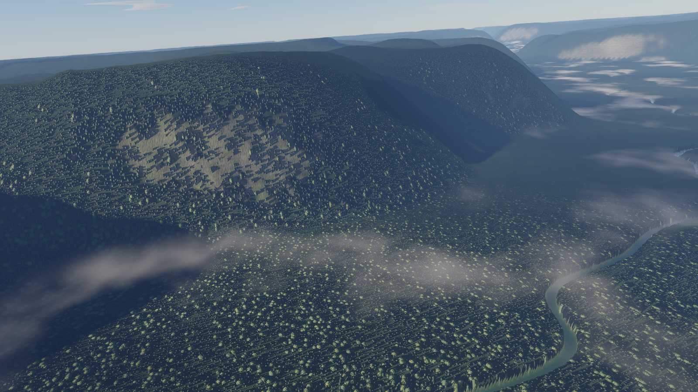
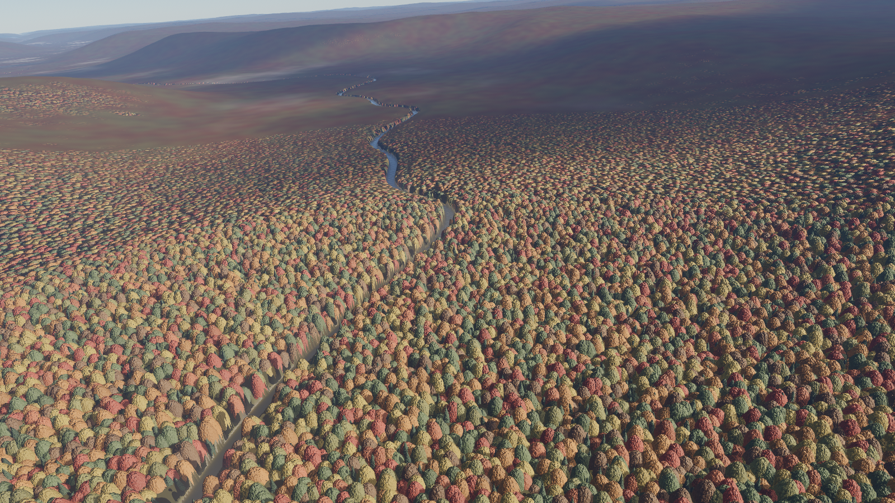
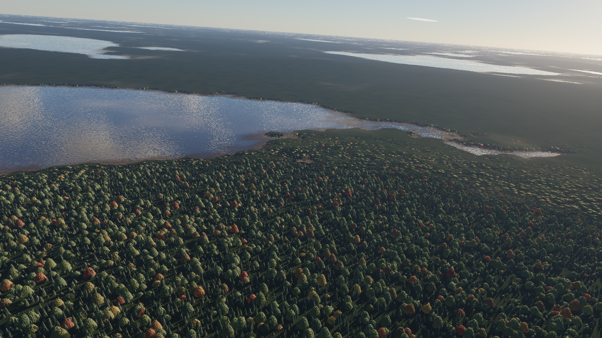
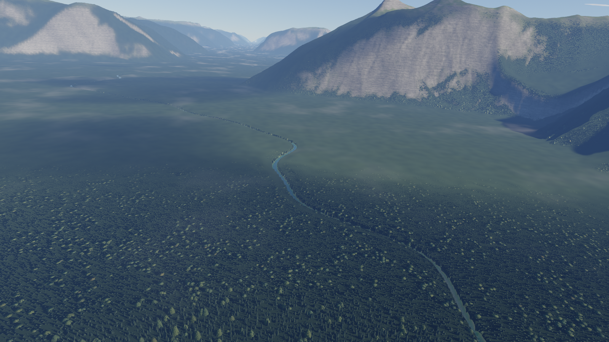
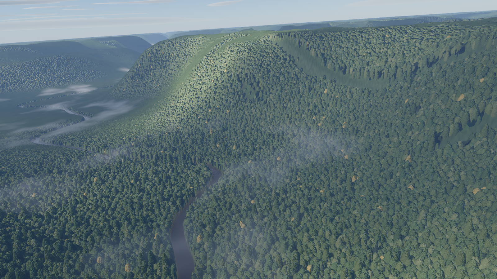

# fayling-web-scenery-pictureframe

A real-time aerial picture frame for a large screen, in the spirit of the Apple TV aerial screen savers. A camera glides a few hundred metres above forested country — following a river valley, banking gently through the bends — and drifts from one region to the next: Cascade rainforest, a New England autumn, boreal lakes, an alpine valley, the Colorado Rockies, a tropical highland, and a Pacific coastline. Everything is generated and lit on the GPU every frame; there are no photos, textures, or video.

It is a sibling of [fayling-web-ocean-pictureframe](https://github.com/jfayling/fayling-web-ocean-pictureframe) and shares its renderer conventions: WebGPU with WGSL shaders, a physically based sky and aerial perspective (Hillaire), reverse-Z depth, HDR rendering with bloom and AgX tone mapping, and the same clock, weather, and sky widgets.



| | |
|---|---|
|  |  |
|  |  |

## Run it

You need a recent Chrome with WebGPU and a reasonably capable GPU. On a laptop, force Chrome onto the dedicated GPU in the Windows graphics settings, or it will fall back to the integrated one.

Open `scenery.html` directly in the browser. `scenery.min.html` is the same page, minified. Both are self-contained and work from `file://`.

To run from source:

```
npm install
npm start        # serves http://localhost:8081/
```

After editing anything under `js/`, run `npm run build` to regenerate both bundles.

## The tour

By default the frame tours all seven regions, about four minutes each, fading through black between them. Each region has its own landform, forest, water, flight altitude and speed, and a matching sky (sun height and direction, haze, clouds). A small label names the region as it fades in.

| Region | Character |
|---|---|
| Pacific Northwest | Steep, eroded Cascade foothills under tall Douglas fir and hemlock, a braided green river, clearcuts in regrowth, valley fog |
| New England Autumn | Rolling White Mountains hills in full colour: sugar maple, red maple, birch gold and oak russet, with scattered spruce |
| Boreal Lakes | Low Canadian Shield country of spruce and birch, dark tannin lakes, bogs, and a low sun |
| Alpine Valley | A glacial trough with spruce forest on the floor and lower walls, rock and snow above the treeline |
| Colorado Rockies | High Front Range massifs under a clear sky, with snow on the valley floor as well as the peaks, rock ribs on the steepest faces, and open spruce standing in the snow |
| Tropical Rainforest | Deeply gullied highlands under a closed broadleaf canopy with emergent crowns, a brown river and heavy mist |
| Pacific Coast | A Big Sur shoreline: open ocean on one side of the view, beaches and cliffed headlands on the other, coastal forest rising behind |

Settings → **Scenery** chooses between the tour (in order or shuffled) and a single region, how long each region lasts, and whether each region brings its own sky. `?scene=alpine` in the URL shows one region.

## Controls

| Input | Action |
|---|---|
| P | Autopilot or free flight |
| L | Dynamic look (returns to the flight view) or static look (holds the angle) |
| [ and ] | Previous or next region |
| Hold left mouse button and drag | Look around. Dynamic look eases back to the flight view; static look stays where you leave it |
| Left and right mouse buttons together | Reset the view |
| W A S D | Move (free flight) |
| Space or E / Q or C | Up / down (free flight) |
| Mouse wheel | Altitude |
| Shift | 5× movement speed |
| T | Show or hide the clock |
| F | Show or hide the weather |
| R | Turn rain on or off |
| F1 or the Settings button | Open the settings panel |
| Esc, H, or the × button | Close the settings panel |

The autopilot follows the valley and keeps a safe height over the terrain ahead, using heights read back from the GPU. **Look behavior**, under Scenery → Flight, chooses whether a dragged view returns to that framing or stays where you aim it. Left and right click together still resets the view. `ui=0` in the URL hides the HUD and buttons for that visit.

## Settings

The panel is an accordion with **General**, **Scenery** (Tour, Flight, Landscape, Quality), **Widgets** (Clock, Weather), and **Sky**. Settings are saved in the browser and restored on refresh; a URL parameter overrides the saved value for that visit only, for example `?forestDensity=1.2&flightAltitude=1.5&exposure=1.6`. **Export**, **Import**, **Share link**, and **Reset to defaults** work as in the ocean frame; the export file is `scenery-settings.json`.

The sky modes come from the ocean frame: Static, Dynamic (follows a ZIP code or place at the current time), Date and time, and Time lapse.

**Sky → Rain** adds rain, thunderstorms, and snow. Rain is off until you turn it on, so an existing tour looks the same. Intensity is shown as a word (Drizzle through Violent; snow runs from Flurries to Blizzard). **Follow weather card** matches the live observation. **Dynamic / real-time** rain does that on its own, and a dynamic sky forces it on so the weather stays in step. A time lapse invents showers, winter snow, and thunderstorms as the sky clock advances, and locks the rain controls while it runs. Storms darken the cloud deck, wet the valley, and flash lightning. Snow is a higher, paler deck with flakes instead of streaks. Fog on the weather card stays dry; the valley already has its own mist.

## How it works

- **Terrain** is a procedural height field: domain-warped gradient noise with rounded ridges, an erosion-style gully filter steered downhill, and a river valley carved out of it along a meandering path. It is baked by compute shaders into nine 512² clipmap levels (2 m to 512 m texels) that follow the camera, together with slope, curvature, and land-cover masks (forest density, conifer fraction, rock, snow).
- **The mesh** is CDLOD: a quadtree of instanced grid patches with smooth morphing between levels, out to 110 km, with Earth curvature.
- **Trees** are individual crowns on a jittered grid — cones for conifers, paraboloid domes for broadleaves — sitting on an understory surface so dense stands close into one canopy. Crowns are displaced into the mesh close to the camera and shaded per pixel with foliage texture, translucency, and self-shadowing; further away a statistical canopy model takes over with the stand mosaic and the sun hotspot.
- **Light** is physically scaled: sun and sky irradiance from the atmosphere model, Lambertian foliage and ground with measured-range albedos, mountain shadows marched through the clipmaps, cloud shadows, valley mist, and froxel aerial perspective.
- **Water** reflects the sky and the wooded banks, shows its bed through clear or tannin-stained water, and carries flowing ripples and sun glint.
- **Rain** is a column of streaks around the aircraft, plus a screen veil, a wetter darker valley, and a low gray deck. Thunderstorms add lightning in the sky and on the land. Snow falls slower, as flakes, under a paler deck. There is no rain sound.

## Development

`tools/shot.ps1` renders a frame in headless Chrome against the dev server and saves it to `shots/`:

```
powershell -ExecutionPolicy Bypass -File tools/shot.ps1 -Name pnw.png -Query "scene=pnw"
```

`dbg=1` shows the land-cover masks (red density, green conifer, blue rock), `dbg=2` the clipmap level, `dbg=3` sun visibility, and `dbg=4` normals. `z=` starts the flight further along the valley. `tools/crop.ps1` enlarges part of a shot for close inspection.

All modules are concatenated into one scope by `build.mjs`, so top-level names must be unique across files.
