<div align="center">

# Fayling Scenery

**A real-time WebGPU aerial screensaver. An autonomous camera flies over procedural forests, mountains, rivers, coasts, and canyons, then over measured lunar terrain. It renders live in your browser, with no prerecorded video.**

[**▶ Live demo**](https://jfayling.github.io/fayling-web-scenery-pictureframe/) · [Download standalone HTML](#quick-start) · [Demo scenes](#jump-straight-to-a-scene) · [How it works](#how-the-procedural-terrain-works)

[](https://github.com/jfayling/fayling-web-scenery-pictureframe/actions/workflows/ci.yml)
[](https://github.com/jfayling/fayling-web-scenery-pictureframe/actions/workflows/pages.yml)
[](LICENSE)


[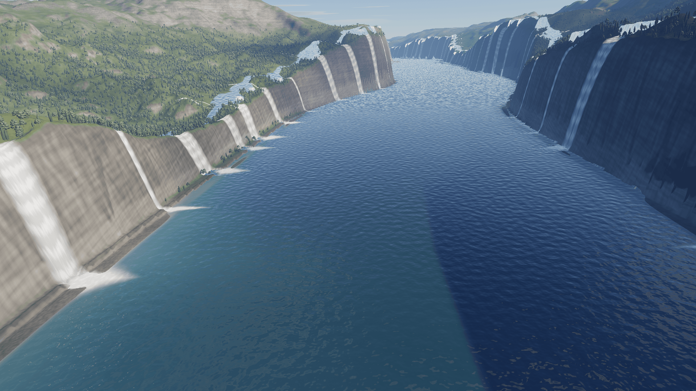](https://jfayling.github.io/fayling-web-scenery-pictureframe/?scene=falls)

<sub>Waterfall Valley. Every pixel is rendered live: procedural terrain, water, trees, and a physically based sky.</sub>

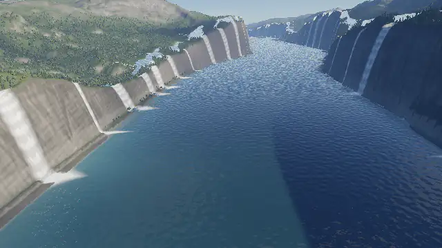

<sub>Six regions, three seconds each, captured frame by frame from the renderer at real autopilot speed.</sub>

</div>

A picture frame for a large screen, in the spirit of the Apple TV aerial screensavers. The camera glides a few hundred metres above the country, follows a river valley, and banks gently through the bends. Every few minutes it fades into the next region. Nothing is filmed or prerecorded. **The Earth landscapes are generated procedurally on the GPU**, and **the Moon regions use measured NASA/SELENE elevation data**. Both are lit by the same physically based renderer.

It is a sibling of [fayling-web-ocean-pictureframe](https://github.com/jfayling/fayling-web-ocean-pictureframe) and shares its renderer conventions: WebGPU with WGSL shaders, a physically based sky and aerial perspective (Hillaire), reverse-Z depth, HDR rendering with bloom and AgX tone mapping, and the same clock, weather, and sky widgets.

## Highlights

- **Cinematic autonomous flight.** An autopilot follows each valley and reads terrain heights back from the GPU to keep a safe clearance. It needs no recorded paths or video files.
- **Nine procedural Earth regions.** Each has its own landform, forest, water, flight altitude, and sky.
- **Five lunar regions from real elevation data.** Copernicus, Aristarchus, Hadley–Apennine, Tycho, and Orientale, built from SLDEM2015 crops and bundled losslessly.
- **Individual trees out to the horizon.** Conifer and broadleaf crowns are drawn individually near the camera, with a statistical canopy model further out.
- **Physically based light.** An atmosphere model, aerial perspective, mountain and cloud shadows, valley mist, and HDR with bloom.
- **Live sky and weather.** Static, real-time, date-and-time, or time-lapse sky. Optional rain, thunderstorms, and snow, which can follow your local weather.
- **One file, zero runtime dependencies.** `scenery.html` is self-contained and runs straight from disk, offline.

## Jump straight to a scene

Every region has a URL. Add `&ui=0` to hide the buttons for a clean, full-screen picture.

| Earth | | Moon | |
|---|---|---|---|
| [Pacific Northwest](https://jfayling.github.io/fayling-web-scenery-pictureframe/?scene=pnw) | `?scene=pnw` | [Copernicus](https://jfayling.github.io/fayling-web-scenery-pictureframe/?scene=moon) | `?scene=moon` |
| [New England Autumn](https://jfayling.github.io/fayling-web-scenery-pictureframe/?scene=new-england) | `?scene=new-england` | [Aristarchus Plateau](https://jfayling.github.io/fayling-web-scenery-pictureframe/?scene=moon-aristarchus) | `?scene=moon-aristarchus` |
| [Boreal Lakes](https://jfayling.github.io/fayling-web-scenery-pictureframe/?scene=boreal) | `?scene=boreal` | [Hadley–Apennine](https://jfayling.github.io/fayling-web-scenery-pictureframe/?scene=moon-hadley) | `?scene=moon-hadley` |
| [Alpine Valley](https://jfayling.github.io/fayling-web-scenery-pictureframe/?scene=alpine) | `?scene=alpine` | [Tycho](https://jfayling.github.io/fayling-web-scenery-pictureframe/?scene=moon-tycho) | `?scene=moon-tycho` |
| [Colorado Rockies](https://jfayling.github.io/fayling-web-scenery-pictureframe/?scene=rockies) | `?scene=rockies` | [Orientale](https://jfayling.github.io/fayling-web-scenery-pictureframe/?scene=moon-orientale) | `?scene=moon-orientale` |
| [Tropical Rainforest](https://jfayling.github.io/fayling-web-scenery-pictureframe/?scene=tropical) | `?scene=tropical` | | |
| [Pacific Coast](https://jfayling.github.io/fayling-web-scenery-pictureframe/?scene=coast) | `?scene=coast` | | |
| [Grand Canyon](https://jfayling.github.io/fayling-web-scenery-pictureframe/?scene=canyon) | `?scene=canyon` | | |
| [Waterfall Valley](https://jfayling.github.io/fayling-web-scenery-pictureframe/?scene=falls) | `?scene=falls` | | |

The [plain URL](https://jfayling.github.io/fayling-web-scenery-pictureframe/) runs the full tour. In the app, the **Next scene** button or the **]** key moves on, and **Settings → Scenery** picks a single region or a custom set.

## Earth landscapes

By default the frame tours nine Earth regions and five lunar regions, about four minutes each, fading through black between them. Each region has its own landform, flight altitude, speed, and sky. Earth regions also have forest and water settings. A small label names the region as it fades in.

| | |
|---|---|
| 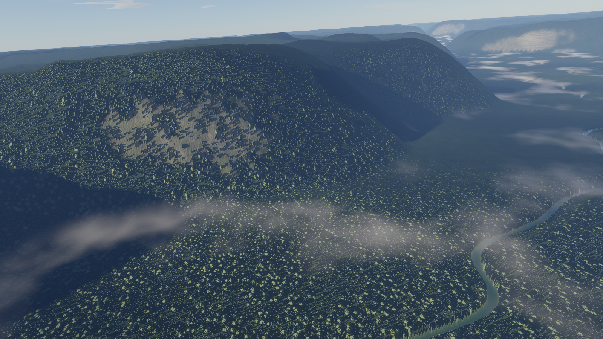 | 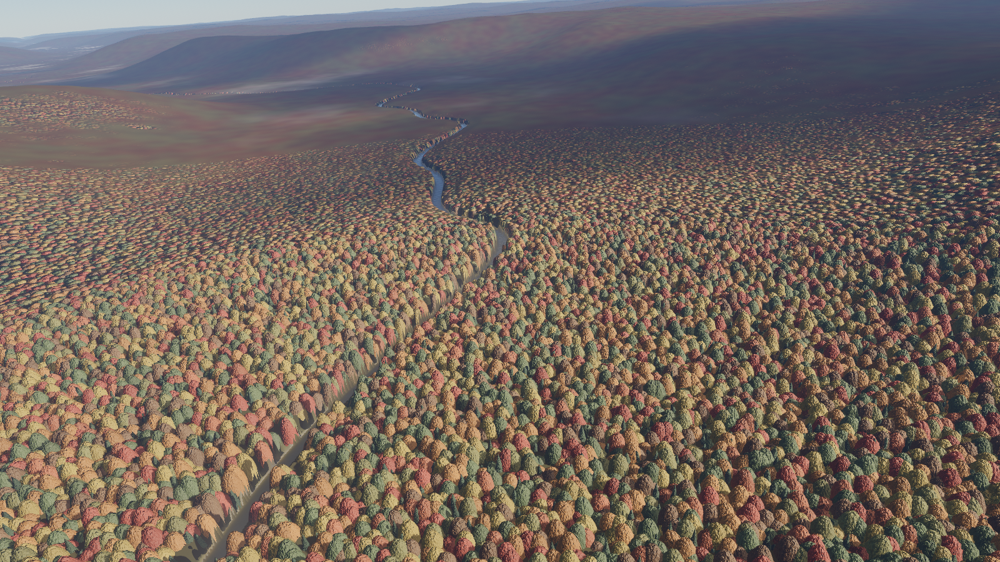 |
| **Pacific Northwest** | **New England Autumn** |
| 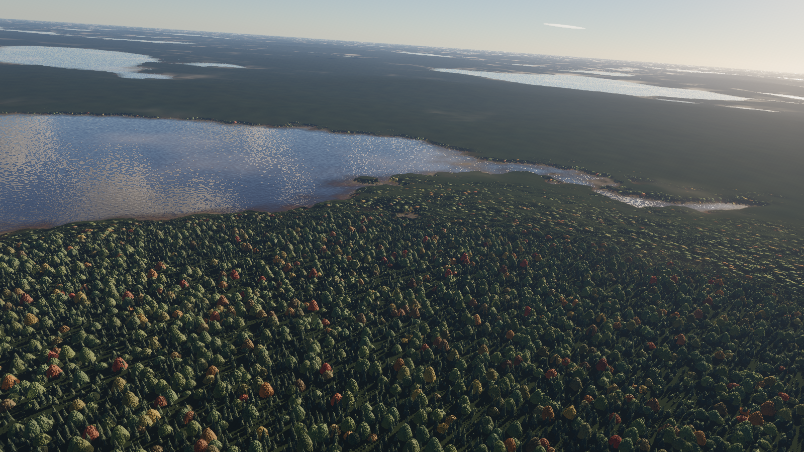 | 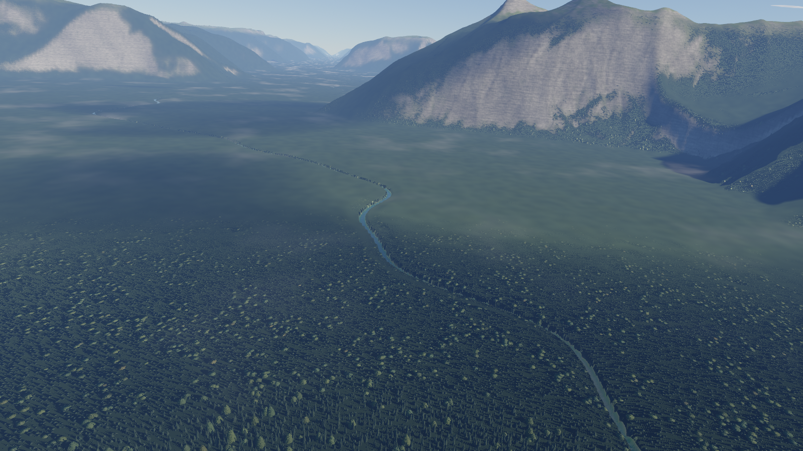 |
| **Boreal Lakes** | **Alpine Valley** |
| 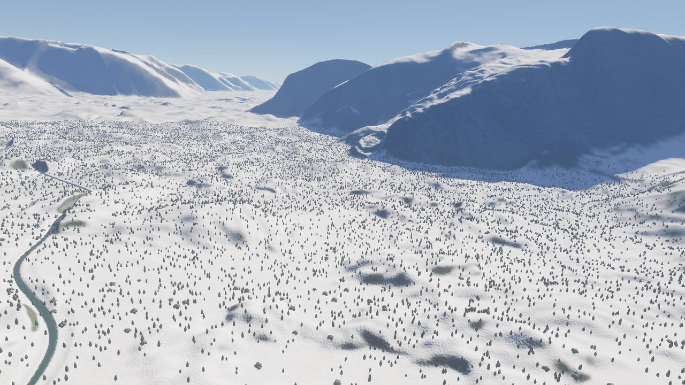 | 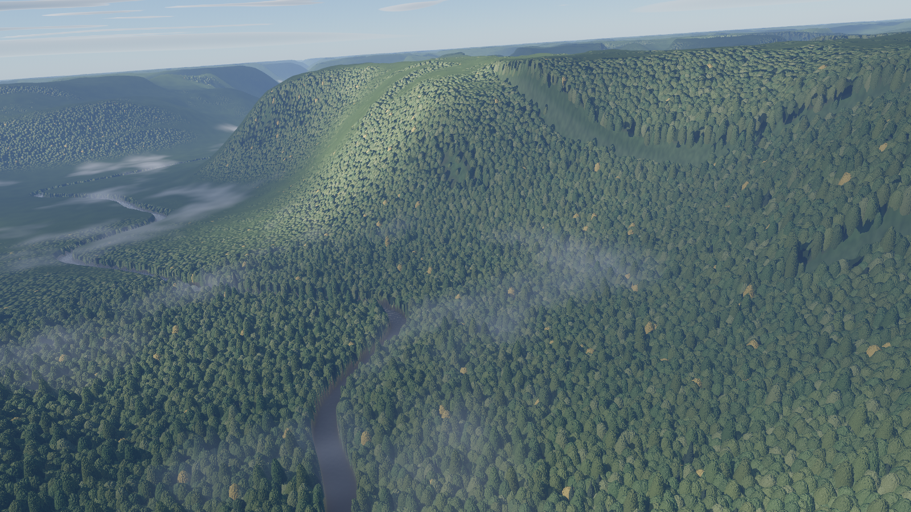 |
| **Colorado Rockies** | **Tropical Rainforest** |
| 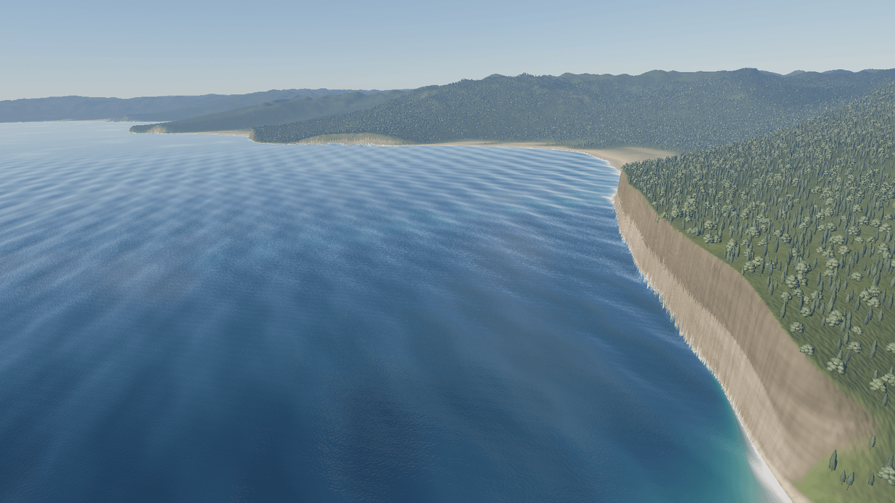 | 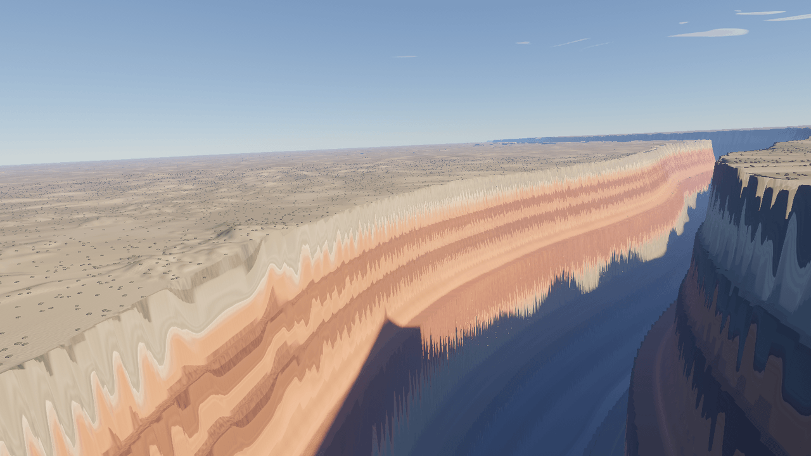 |
| **Pacific Coast** | **Grand Canyon** |

| Region | Character |
|---|---|
| Pacific Northwest | Steep, eroded Cascade foothills under tall Douglas fir and hemlock, a braided green river, clearcuts in regrowth, valley fog |
| New England Autumn | Rolling White Mountains hills in full colour: sugar maple, red maple, birch gold and oak russet, with scattered spruce |
| Boreal Lakes | Low Canadian Shield country of spruce and birch, dark tannin lakes, bogs, and a low sun |
| Alpine Valley | A glacial trough with spruce forest on the floor and lower walls, rock and snow above the treeline |
| Colorado Rockies | High Front Range massifs under a clear sky, with snow on the valley floor as well as the peaks, rock ribs on the steepest faces, and open spruce standing in the snow |
| Tropical Rainforest | Deeply gullied highlands under a closed broadleaf canopy with emergent crowns, a brown river and heavy mist |
| Pacific Coast | A Big Sur shoreline: open ocean on one side of the view, beaches and cliffed headlands on the other, coastal forest rising behind |
| Grand Canyon | A gorge in the Colorado Plateau: flat rims, stepped red and cream cliffs, temples, a silty river, and scattered juniper on the rim |
| Waterfall Valley | A Fiordland trough: a river the full width of the valley, sheer walls, and waterfalls spilling from tarns along the rims |

Settings → **Scenery** chooses between the tour (in order or shuffled) and a single region, how long each region lasts, and whether each region brings its own sky. `?scene=alpine` in the URL shows one region.

## Lunar exploration

The five Moon regions aren't procedural. They are flown over **measured elevation data** from [SLDEM2015](https://pgda.gsfc.nasa.gov/products/54), which combines NASA LRO laser altimetry with JAXA SELENE/Kaguya stereo imaging. The crops are bundled losslessly in the HTML, so they work offline. Each scene has its own camera route, terrain clearance, and low-Sun lighting under a black, airless sky.

| | |
|---|---|
|  | 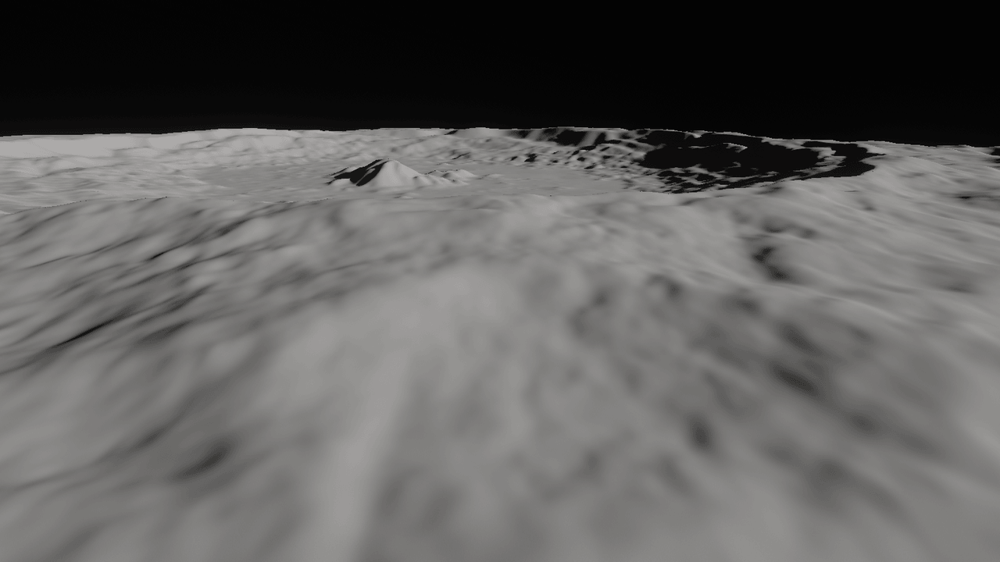 |
| **Copernicus** | **Tycho** |

| Region | URL parameter | Route |
|---|---|---|
| Copernicus | `?scene=moon` | Southern rim, floor, central peaks, northern rim |
| Aristarchus Plateau | `?scene=moon-aristarchus` | Aristarchus crater, valley mouth, Vallis Schröteri, northern plateau |
| Hadley–Apennine | `?scene=moon-hadley` | Southern mountains, Hadley Rille, Apollo 15 region, mountain front |
| Tycho | `?scene=moon-tycho` | Southern highlands, terraced walls, central peaks, northern rim |
| Orientale | `?scene=moon-orientale` | Northern basin floor and Rook mountain rings |

Under Settings → Scenery, select **One region**, then a **Moon** region. See [Moon terrain](docs/planet-terrain.md) for data sources, resolution, visual limits, and rebuild instructions.

## Quick start

**Online:** open the [live demo](https://jfayling.github.io/fayling-web-scenery-pictureframe/) in desktop Chrome or Edge.

**Offline / kiosk:** download the zip from the [latest release](https://github.com/jfayling/fayling-web-scenery-pictureframe/releases/latest), or save [`scenery.html`](https://jfayling.github.io/fayling-web-scenery-pictureframe/scenery.html) (readable) or [`scenery.min.html`](https://jfayling.github.io/fayling-web-scenery-pictureframe/scenery.min.html) (minified) from the live site. Then open the file directly in the browser. Both are self-contained and work from `file://`. For background music, put the `media/` folder next to the file. The frame runs silently without it.

For a dedicated display, open the page full screen (**F11**) with `?ui=0`, and force the browser onto the dedicated GPU. See [troubleshooting](docs/troubleshooting.md#it-runs-on-the-integrated-gpu-and-is-slow).

**From source:**

```
git clone https://github.com/jfayling/fayling-web-scenery-pictureframe.git
cd fayling-web-scenery-pictureframe
npm ci
npm start        # serves http://localhost:8081/
```

After editing anything under `js/`, run `npm run build` to regenerate both bundles.

## Controls

| Input | Action |
|---|---|
| P | Autopilot or free flight |
| L | Dynamic look (returns to the flight view) or static look (holds the angle) |
| [ and ] | Previous or next region |
| M | Music on or off |
| Hold left mouse button and drag | Look around. Dynamic look eases back to the flight view; static look stays where you leave it |
| Left and right mouse buttons together | Reset the view |
| W A S D | Move (free flight) |
| Space or E / Q or C | Up / down (free flight) |
| Mouse wheel | Altitude |
| Shift | 5× movement speed |
| T | Show or hide the clock |
| F | Show or hide the weather |
| R | Turn rain on or off |
| F1 or the Settings button | Open the settings panel |
| Esc, H, or the × button | Close the settings panel |

The autopilot follows the valley and keeps a safe height over the terrain ahead, using heights read back from the GPU. **Look behavior**, under Scenery → Flight, chooses whether a dragged view returns to that framing or stays where you aim it. Left and right click together still resets the view. `ui=0` in the URL hides the HUD and buttons for that visit.

## Settings

The panel is an accordion with **General**, **Scenery** (Tour, Flight, Landscape, Quality), **Widgets** (Clock, Weather), and **Sky**. Settings are saved in the browser and restored on refresh; a URL parameter overrides the saved value for that visit only, for example `?forestDensity=1.2&flightAltitude=1.5&exposure=1.6`. **Export**, **Import**, **Share link**, and **Reset to defaults** work as in the ocean frame; the export file is `scenery-settings.json`.

The sky modes come from the ocean frame: Static, Dynamic (follows a ZIP code or place at the current time), Date and time, and Time lapse.

**Sky → Rain** adds rain, thunderstorms, and snow. Rain is off until you turn it on, so an existing tour looks the same. Intensity is shown as a word (Drizzle through Violent; snow runs from Flurries to Blizzard). **Follow weather card** matches the live observation. **Dynamic / real-time** rain does that on its own, and a dynamic sky forces it on so the weather stays in step. A time lapse invents showers, winter snow, and thunderstorms as the sky clock advances, and locks the rain controls while it runs. Storms darken the cloud deck, wet the valley, and flash lightning. Snow is a higher, paler deck with flakes instead of streaks. Fog on the weather card stays dry; the valley already has its own mist.

## Technical architecture

```
index.html ─┐                       ┌─ scenery.html      (readable, self-contained)
js/*.js ────┼── build.mjs ──────────┤
js/wgsl/*.js┘  (concatenate, strip  └─ scenery.min.html  (esbuild + WGSL minifier)
               module syntax)
```

| Module | Role |
|---|---|
| `js/main.js` | WebGPU device, render graph, clipmap scheduling, autopilot, settings panel, widgets |
| `js/scenes.js` | The Earth and Moon regions: landform, forest, water, flight, and sky parameters |
| `js/camera-route.js` | Smooth geographic routes for the lunar flyovers |
| `js/planet-terrain.js` | Lossless decoder for the bundled lunar elevation crops |
| `js/moon*-data.js` | Compressed SLDEM2015 crops (generated by `tools/prepare-moon.py`) |
| `js/wgsl/terrain.js` | Height-field bake and GPU height probes for the autopilot |
| `js/wgsl/land.js`, `forest.js`, `trees.js` | Ground shading, canopy model, and individual tree crowns |
| `js/wgsl/sky.js` | Atmosphere LUTs, sky view, aerial perspective, clouds, and shadows |
| `js/wgsl/rain.js`, `post.js` | Precipitation, bloom, and tone mapping |
| `js/astronomy.js`, `star-catalog.js` | Sun, Moon, and star positions for the dynamic sky |
| `js/weather.js`, `place.js` | Optional live weather and place lookup |

All per-frame data lives in preallocated typed arrays and descriptors, so the frame loop creates no garbage apart from the swap-chain view and command buffer.

## How the procedural terrain works

- **Terrain** is a procedural height field: domain-warped gradient noise with rounded ridges, an erosion-style gully filter steered downhill, and a river valley carved out of it along a meandering path. Compute shaders bake it into nine 512² clipmap levels (2 m to 512 m texels) that follow the camera, together with slope, curvature, and land-cover masks (forest density, conifer fraction, rock, snow).
- **The mesh** is CDLOD: a quadtree of instanced grid patches with smooth morphing between levels, out to 110 km, with Earth curvature.
- **Trees** are individual crowns on a jittered grid: cones for conifers, paraboloid domes for broadleaves. They sit on an understory surface, so dense stands close into one canopy. Near the camera, crowns are displaced into the mesh and shaded per pixel with foliage texture, translucency, and self-shadowing. Further away, a statistical canopy model takes over with the stand mosaic and the sun hotspot.
- **Light** is physically scaled: sun and sky irradiance from the atmosphere model, Lambertian foliage and ground with measured-range albedos, mountain shadows marched through the clipmaps, cloud shadows, valley mist, and froxel aerial perspective.
- **Water** reflects the sky and the wooded banks, shows its bed through clear or tannin-stained water, and carries flowing ripples and sun glint.
- **Rain** is a column of streaks around the aircraft, plus a screen veil, a wetter darker valley, and a low gray deck. Thunderstorms add lightning in the sky and on the land. Snow falls slower, as flakes, under a paler deck. There is no rain sound.
- **The Moon** replaces the procedural height function with the measured elevation crop, reconstructed with a cubic B-spline. The mesh and the autopilot's height probes sample the same field, with lunar curvature and no atmosphere. Nothing is exaggerated or added: there are no procedural craters.

## GPU requirements and browser support

- A browser with **WebGPU**. Desktop Chrome or Edge on Windows is the tested target. See [browser support](docs/browser-support.md) for other browsers.
- A **secure context**: HTTPS (the live demo), `localhost`, or a local file.
- A **reasonably capable GPU**. A discrete GPU is recommended; integrated GPUs may run slowly. On a laptop, force the browser onto the dedicated GPU in the Windows graphics settings.
- The drawing target is capped at a 1440p pixel budget and scales down automatically when frames run long. **Settings → Scenery → Quality → Render scale** adjusts it.

There is no WebGL fallback. If the page reports that WebGPU is unavailable, see [troubleshooting](docs/troubleshooting.md).

## Build and development

| Command | What it does |
|---|---|
| `npm start` | Dev server at `http://localhost:8081/`, serving the module sources |
| `npm run build` | Regenerates `scenery.html` and `scenery.min.html` |
| `npm test` | Camera route and lunar terrain decoding tests |
| `npm run site` | Builds, then assembles and checks the GitHub Pages site in `_site/` |
| `node tools/check-site.mjs [url]` | Loads the Pages site in headless Chrome (local `_site` under the Pages path prefix, or a live URL) and checks the entry point, metadata, assets, and several scenes |
| `node tools/check-scenes.mjs` | Windows GPU integration check: every lunar region, both offline bundles, scene transitions |
| `node tools/make-media.mjs` | Regenerates `docs/hero.png`, `docs/social-preview.png`, and `docs/preview.webp` from real renders (needs `npm install --no-save sharp`) |

`tools/shot.ps1` renders a frame in headless Chrome against the dev server and saves it to `shots/`:

```
powershell -ExecutionPolicy Bypass -File tools/shot.ps1 -Name pnw.png -Query "scene=pnw"
```

`dbg=1` shows the land-cover masks (red density, green conifer, blue rock), `dbg=2` the clipmap level, `dbg=3` sun visibility, and `dbg=4` normals. `z=` starts the flight further along the valley. `seq=` and `step=` capture a sequence of frames, `step` frames apart, in screenshot mode. `tools/crop.ps1` enlarges part of a shot for close inspection.

All modules are concatenated into one scope by `build.mjs`, so top-level names must be unique across files.

Every push to `main` runs [CI](.github/workflows/ci.yml): build, a check that the committed bundles match the sources, the tests, and a site check. The [Pages workflow](.github/workflows/pages.yml) then deploys the minified bundle as the live demo.

## Living Frames: Related Projects

Three browser-based picture frames for a large screen, sharing one renderer style and the same clock, weather, and sky widgets:

| Project | |
|---|---|
| **[Scenery](https://github.com/jfayling/fayling-web-scenery-pictureframe)** (this repository) | Autonomous aerial flyovers of procedural landscapes and measured lunar terrain. [Live demo](https://jfayling.github.io/fayling-web-scenery-pictureframe/) |
| **[Ocean](https://github.com/jfayling/fayling-web-ocean-pictureframe)** | A real-time WebGPU ocean: simulated waves and glitter, a sun, moon, and stars driven by your location, drifting clouds, procedural sound, a clock, and live weather. [Live demo](https://jfayling.github.io/fayling-web-ocean-pictureframe/) |
| **[Fish tank](https://github.com/jfayling/fayling-web-fishtank-pictureframe)** | A real-time WebGPU saltwater reef aquarium. Procedural live rock and ten kinds of coral, with twelve species of reef fish that school, shelter, and rest on their own. |

## Contributing

Bug reports, screenshots of rendering problems, new regions, and performance work are welcome. Read [CONTRIBUTING.md](CONTRIBUTING.md) first. The short version: no runtime dependencies, keep `scenery.html` working from disk, and commit the rebuilt bundles. For problems getting it to run, see [troubleshooting](docs/troubleshooting.md).

## License and attribution

The code is released under the [MIT License](LICENSE).

The lunar regions use SLDEM2015 elevation data from NASA/GSFC and the MIT LOLA archive, combining LRO LOLA and SELENE Terrain Camera measurements. Barker, M. K. et al. (2016), "A new lunar digital elevation model from the Lunar Orbiter Laser Altimeter and SELENE Terrain Camera," *Icarus*, 273, 346–355, [doi:10.1016/j.icarus.2015.07.039](https://doi.org/10.1016/j.icarus.2015.07.039). The star field uses the public-domain Yale Bright Star Catalogue. See [ATTRIBUTION.md](ATTRIBUTION.md) for all data sources, services, and contributors.
