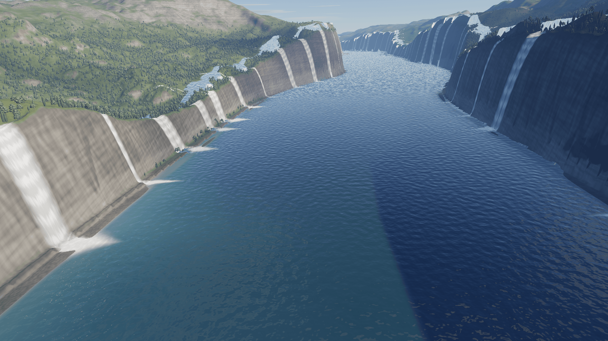

# Fayling Scenery v1.0.0

The first public release of the scenery picture frame: a real-time WebGPU aerial screensaver. An autonomous camera flies over procedural forests, mountains, rivers, coasts, and canyons, then over measured lunar terrain. Everything renders live in the browser, with no prerecorded video.

**▶ Live demo:** https://jfayling.github.io/fayling-web-scenery-pictureframe/

## Highlights

- **Nine procedural Earth regions:** Pacific Northwest, New England Autumn, Boreal Lakes, Alpine Valley, Colorado Rockies, Tropical Rainforest, Pacific Coast, Grand Canyon, and Waterfall Valley.
- **Five lunar regions from measured elevation data:** Copernicus, Aristarchus Plateau, Hadley–Apennine, Tycho, and Orientale, from NASA/GSFC SLDEM2015 (LRO LOLA + SELENE TC), bundled losslessly for offline use.
- **Autonomous flight:** an autopilot follows each valley or lunar route and reads terrain heights back from the GPU to hold its clearance. Free flight is available with **P**.
- **Physically based rendering:** Hillaire atmosphere and aerial perspective, CDLOD terrain to 110 km with planetary curvature, individual tree crowns, mountain and cloud shadows, water reflections, HDR with bloom and AgX tone mapping.
- **Sky and weather:** static, real-time, date-and-time, and time-lapse skies, plus optional rain, thunderstorms, and snow that can follow your live local weather.
- **Widgets:** clock and live weather card, from the sibling ocean frame.
- **Standalone:** one self-contained HTML file with zero runtime dependencies. It works offline from `file://`.

## Downloads

| File | Description |
|---|---|
| `fayling-scenery-v1.0.0.zip` | `scenery.html`, `scenery.min.html`, `media/` (optional music), `LICENSE`, `ATTRIBUTION.md` |
| `scenery.html` | Readable self-contained bundle (~10 MB) |
| `scenery.min.html` | Minified self-contained bundle (~10 MB) |

## Setup

1. Download `fayling-scenery-v1.0.0.zip` and extract it.
2. Open `scenery.html` (or `scenery.min.html`) in desktop Chrome or Edge.
3. For a dedicated display, press **F11** for full screen. Add `?ui=0` to the URL to hide the buttons, and `?scene=falls` (or any region id) to show one region.
4. On a laptop, set the browser to **High performance** under Windows **Settings → System → Display → Graphics** so it uses the dedicated GPU.

## Supported browsers

| Browser | Status |
|---|---|
| Chrome / Edge, desktop Windows | Tested target |
| Chrome / Edge, macOS and ChromeOS | Expected to work where WebGPU is enabled; not regularly tested |
| Safari, Firefox | WebGPU is shipping in recent versions; untested, reports welcome |
| Mobile | Not a target |

WebGPU requires HTTPS, `localhost`, or a local file. There is no WebGL fallback. See [browser support](https://github.com/jfayling/fayling-web-scenery-pictureframe/blob/v1.0.0/docs/browser-support.md).

## Known limitations

- **WebGPU only.** Browsers without WebGPU show an error page with a link to troubleshooting.
- **GPU-heavy.** Designed for a discrete GPU driving a large screen. Integrated GPUs may run at a low frame rate. Resolution scales down automatically only when the adapter supports `timestamp-query`.
- **Lunar crops are regional.** Free flight near the edge of a crop shows its boundary. Lunar surface colour is artistic, not measured imagery.
- **Equirectangular approximation.** Each lunar crop uses a local equirectangular approximation, with visible distortion across the large Orientale crop.
- **Weather and place search need the network** (Open-Meteo, api.weather.gov). Rendering does not.
- **Music** loads from `media/` next to the page. A lone HTML file without that folder runs silently.
- **No rain sound.**

## Credits

Jason Fayling, and Dan Price ([@g051051](https://github.com/g051051)) for the measured lunar terrain and the lunar regions. Lunar elevation data from SLDEM2015, Barker et al. (2016), *Icarus* 273, 346–355, doi:10.1016/j.icarus.2015.07.039. See [ATTRIBUTION.md](https://github.com/jfayling/fayling-web-scenery-pictureframe/blob/v1.0.0/ATTRIBUTION.md).

Part of the **Living Frames** family, with [Ocean](https://github.com/jfayling/fayling-web-ocean-pictureframe) and [Fish tank](https://github.com/jfayling/fayling-web-fishtank-pictureframe).
